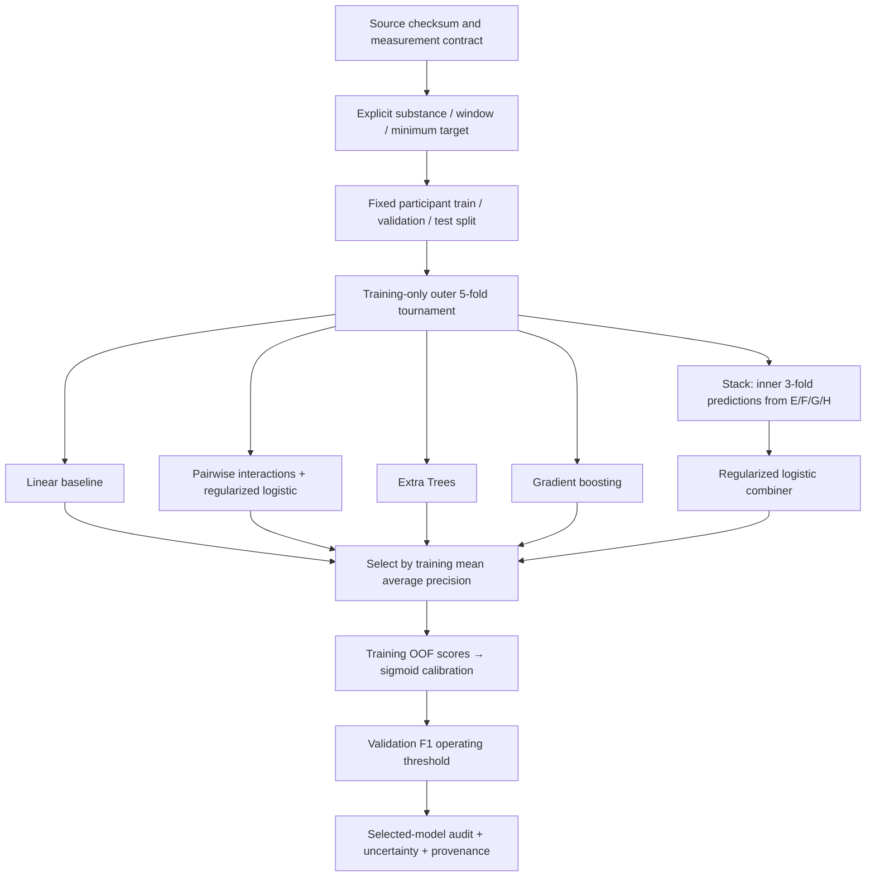

# Personality Studio

**From a creative questionnaire-to-model idea to an inspectable research application.**

Explore your personality locally, define exactly what a reported-use outcome means, and examine an advanced machine-learning pipeline through interactive diagrams and real evaluation charts. Built from Amir Edris’s [original project](https://github.com/AmirMEdris/PredictingDrugUse), which remains unchanged.

> **Status:** the personality app and UCI research workbench run today. The matched IPIP-to-substance model is blocked on LISS access, permitted processing/model release, and sufficient matched observations. The app does not infer drug use from questionnaire answers. No clinical or future-risk claim is made.

## Start in one command

Python 3.12+; no runtime package installation, GPU or account required for the web application:

```sh
python -m personality.server
```

Open **http://127.0.0.1:8765/workbench** for the new research experience, or **http://127.0.0.1:8765** for the questionnaire, target playground and original baseline explorer. On Windows, `py -3 -m personality.server` works too. Use `--port 8766` if needed. Stop with Ctrl+C.

### What you can explore

- **Personality:** 50 IPIP items, correctly keyed named traits, raw-score profiles and progress. No responses are persisted or sent to a remote service.
- **Pipeline:** six selectable stages explain acquisition, target engineering, splitting, model selection, calibration and audit.
- **Outcome engineering:** recent breadth, substance-specific profiles and recency sensitivity, clearly marked as implemented or proposed.
- **Missing-data laboratory:** see when incomplete substance answers still establish a label, and when the result must remain unknown.
- **Evidence dashboard:** cross-validation comparison, validation permutation importance, audit precision–recall and reliability curves, validation threshold trade-offs and training co-occurrence counts.
- **Reproducible evidence:** download the exact displayed JSON report. Every metric shown comes from a completed run, not a mockup.

## The advanced architecture



All imputation and scaling are fitted within model pipelines inside the appropriate training folds. The stack learns from out-of-fold base predictions, not in-sample predictions. No synthetic respondents or pre-split resampling are used. Calibration uses training OOF scores; validation selects the threshold. The test partition is used for the selected-model audit only in the new runner.

**This UCI test partition has already been inspected in earlier work.** Keeping the original split avoids disguising a new random partition as fresh evidence. Results are an internal benchmark, not external validation. Global quantification performed by the source authors cannot be undone by fold-local scaling.

## Actual results: complexity was tested, not assumed superior

Default target: at least two of amphetamines, cocaine, crack and ketamine reported within the past month. UCI provides 1,885 respondents, including 98 matches. Features are seven source-quantified personality/impulsivity/sensation measures; no substance outcome is a predictor.

| Candidate | Training 5-fold mean AP |
|---|---:|
| Extra Trees | 0.1611 |
| Regularized linear | 0.1610 |
| Stacked ensemble | 0.1485 |
| Boosted trees | 0.1287 |
| Pairwise interactions | 0.1250 |

The numerical difference between the top two is tiny; it is not evidence of statistically established superiority. The predeclared rule selected Extra Trees. On the 377-person internal audit partition (20 positives), calibrated Extra Trees achieved:

| Measure | Result |
|---|---:|
| Average precision / constant baseline | 0.1322 / 0.0531 |
| AP bootstrap 95% interval | 0.0712–0.2848 |
| Precision / recall | 15.8% / 15.0% |
| True positives / false positives | 3 / 16 |
| False negatives / true negatives | 17 / 341 |
| ROC AUC | 0.7485 |
| Brier score | 0.04851 |

**This remains weak for individual inference.** Internal calibration and a complex model do not solve the measurement mismatch or small positive class. The cloud CPU run completed in 7.7 seconds; it did not use the laptop GPU. [Full report](artifacts/workbench/report.json).

## Reproduce the research pipeline

```sh
python -m venv .venv
# Windows: .venv\Scripts\activate
# macOS/Linux: source .venv/bin/activate
python -m pip install -r requirements.txt
python -m personality.data
python -m personality.run_workbench --output experiments/my-run
```

The launcher runs CPU-only with one numerical thread and a four-hour process timeout. Use a fresh output directory: the runner refuses to overwrite earlier evidence. The protocol is written before candidate scores; selection is written before the test audit. A failed/timeout run is incomplete, even if some files exist.

Outputs: `protocol.json`, `selection.json`, `report.json`, `checkpoint.joblib`, `checkpoint.sha256`. Checkpoints stay in ignored `experiments/`; only aggregate reports belong in the public repository. Joblib can execute code: load **only a checkpoint you trained locally**. Its checksum detects accidental changes; it is not proof of trust.

For local research inference, create a JSON file with `measurement: "uci_quantified_neo"` and a `features` object containing exactly the seven names in the protocol, then run:

```sh
python -m personality.predict_workbench --run experiments/my-run --input example.json
```

This CLI uses the selected advanced model and calibrator. It rejects IPIP measurement labels. The original web demo retains its portable JSON baseline model; the new workbench visualizes the advanced run. Neither accepts questionnaire answers as UCI features.

## The matched-data route

LISS documents the same 50 IPIP item statements and five-point accuracy scale. Its 2008 personality wave precedes the November substance survey, with past-30-day cannabis, ecstasy, cocaine and heroin outcomes. This could preserve the original concept with an explicit change in substance selection.

`personality/liss.py` is a **fixture-tested adapter**, not a trained LISS model. It joins on participant identity, rejects duplicate IDs and contradictory routing, preserves missingness, and assigns count labels only when the known bounds establish them. It has not been validated on actual LISS records. Household grouping, missingness audit, language/population generalization, class counts and permissions must be settled before real training.

No LISS records have been acquired, no terms accepted, and no account created. [LISS access conditions](https://www.lissdata.nl/how-it-works-archive), [actual agreement](https://liss.statements.centerdata.nl/), [personality codebook](https://dataarchive.lissdata.nl/hosted-files/download/113), [substance codebook](https://dataarchive.lissdata.nl/hosted-files/download/379).

## Verification and maintenance

```sh
python -m unittest discover -s tests -v
node --check web/app.js
node --check web/workbench.js
# Optional real-browser verification:
python -m pip install playwright==1.62.0
python -m playwright install chromium
PYTHONPATH=. python tests/browser_workbench.py
```

On PowerShell, set `$env:PYTHONPATH='.'` before the browser command. Browser tests cover pipeline navigation, report rendering, missing-label logic, threshold interaction and mobile overflow. Local verification: 13 automated tests passed, JavaScript syntax checks passed, and advanced checkpoint inference plus measurement rejection were verified. Browser rendering is **not yet verified** in this environment: the browser download returned an invalid archive and system Chromium was blocked by a required socket permission. CI includes the browser checks but has not run for this revision.

Unit tests cover identity joins, missing/contradictory outcomes, stacking with fold-local missing features, existing target semantics, portable baseline parity and server access controls.

The application binds to loopback, uses a restrictive CSP, serves fixed routes, and stores no questionnaire responses. It is a local research application, not a hardened multi-user hosted service. No telemetry or external web assets are loaded.

## Navigate the project

| Area | Entry point |
|---|---|
| Advanced experiment / resource bounds | `personality/workbench.py` / `run_workbench.py` |
| Local advanced inference | `personality/predict_workbench.py` |
| LISS metadata-derived adapter | `personality/liss.py` |
| Questionnaire and baseline | `web/app.js`, `personality/core.py` |
| Interactive workbench | `web/workbench.html`, `.js`, `.css` |
| Design decisions and data contracts | [Engineering decisions](docs/ENGINEERING.md) |
| Original experiment details | [Baseline documentation](docs/LEGACY_BENCHMARK.md) |
| Measurement and source permissions | [Measurement](docs/MEASUREMENT.md), [Sources](docs/SOURCES.md) |

IPIP items are public domain; UCI data is CC BY 4.0 with attribution documented in Sources. No software licence or LISS redistribution permission is assigned on Amir’s behalf.
